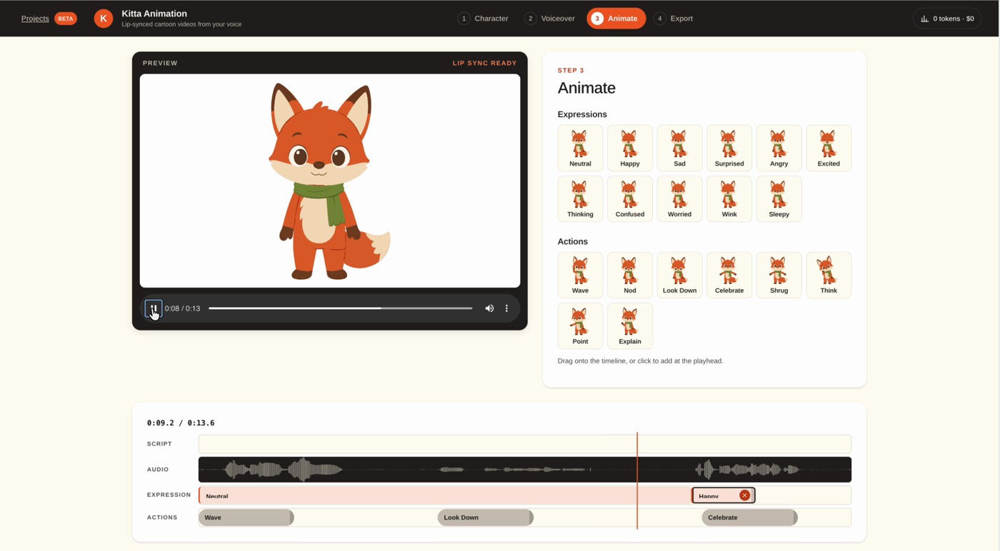

# Kitta Animation

Local app that makes lip-synced cartoon character videos: pick or create a character, give it a voice, fine-tune its expressions and gestures on a timeline, and export the video.

[](/demo2.mov)

*A vector character (made with **Create vector character**) speaking and gesturing. Click for the video. The [first version's demo](/demo.mov) shows the starter characters.*


## Setup

```
npm i
cp .env.example .env     # then add the keys you want (all optional, see below)
npm run dev
```

Open http://localhost:5173: the Character Studio is the home page. Projects (in beta) is behind the **Projects · Beta** button, at http://localhost:5173/?projects. Lip sync uses Rhubarb, which is bundled as a WASM package, so there is nothing else to install (no `npm run setup`). Needs Node 21.7 or newer (the server uses `process.loadEnvFile`) and `ffmpeg` on your PATH.

Which keys turn on what (all in `.env`, server only, never sent to the browser):

| Key | Turns on |
|---|---|
| `GEMINI_API_KEY` | Gemini voices, auto-tagging, transcription, AI pictures |
| `OPENAI_API_KEY` | OpenAI voices and pictures, and drawing **vector characters** (default model `gpt-6.2-astra`) |
| `ELEVENLABS_API_KEY` | ElevenLabs voices, with the voices on your account |
| `ANTHROPIC_API_KEY` | Claude as the vector drawing model instead of OpenAI (`VECTOR_DRAW_PROVIDER=anthropic`) |
| `VOICESTUDIO_URL` | VoiceStudio, a free local voice app |

Without any key you can still pick a starter, upload audio, lip-sync, animate and export.

## How to use

1. **Character**: pick a starter and customise it, **Create with AI** (a painted picture character, see below), or **Create vector character** (a character drawn as parts on a skeleton, see [Vector characters](#vector-characters)).
2. **Voiceover**: either upload audio (up to 3 minutes), or write a script and click "Generate voice". "Add expressions" (after an upload) and "Auto-tag expressions" (in the script) let Gemini pick the expression and gesture per line; you can change any of them afterwards, for uploads too (each line of an uploaded clip is listed under the upload button).
   Expressions: neutral, happy, sad, surprised, angry, excited, thinking, confused, worried, wink, sleepy. Gestures: wave, nod, look down, celebrate, shrug. The Character step shows your character's whole expression set.
3. **Animate**: fine-tune the performance on a timeline under the voiceover. Drag an expression or action from the palette onto the timeline (or click it to add it at the playhead). An expression lasts until the next one, unless you drag its right edge to end it sooner: then the expression before it shows again. An action plays once over its clip. Drag blocks to move them, drag a clip's right edge to make it longer or shorter, and select a block and press Delete (or ×) to remove it. The timeline starts from the expressions and gestures chosen in the Voiceover step. Once you edit it here, it drives the video, and the per-line pickers in the Voiceover step no longer do. New audio, or "Add expressions" again, starts it over.
4. **Export**: choose 16:9 or 9:16, or transparent, and download the MP4/WebM.

Upload, lip sync and export work without any key. Voice generation needs one of the voice providers (see [Voices](#voices)). "Add expressions" and "Auto-tag" need `GEMINI_API_KEY`; without one those buttons are disabled (you can still set the expression and gesture by hand). Gemini has a free tier with rate limits; if it is hit, the app shows "Free Gemini limit reached, try again later".

## Voices

The "Write script" tab can speak with four providers ("Voice by" appears when more than one is set up):

- **Gemini TTS** (`GEMINI_API_KEY`): the default. A neutral line with no delivery note is sent as just its text; otherwise the expression and note go in separate director's notes, so they shape the delivery without being read out.
- **OpenAI** (`OPENAI_API_KEY`, `OPENAI_TTS_MODEL`, default `gpt-4o-mini-tts`): the line's expression and delivery note become speaking instructions.
- **ElevenLabs** (`ELEVENLABS_API_KEY`, `ELEVENLABS_MODEL`, default `eleven_multilingual_v2`): the voice picker lists the voices on your ElevenLabs account, including cloned and designed ones. It speaks the words only: the expression, delivery note, language and cues are not sent, while pitch and speed are applied afterwards like the others. Billed per character ($0.08 per 1,000 for multilingual v2 and v3, $0.04 for Flash).
- **VoiceStudio (local, free)**: [VoiceStudio](https://github.com/debpalash/VoiceStudio) runs open voice models on your own machine (voice cloning, 600+ languages). Install it, then set `VOICESTUDIO_URL=http://localhost:3900`. You don't need to start it yourself: when "Voice by" is VoiceStudio and it isn't running, Kitta opens the app in the background (macOS, `/Applications/VoiceStudio.app`, or set `VOICESTUDIO_APP`) and waits until its models are loaded. The script tab then shows whether it is running, an **Engine** picker (the engines installed in VoiceStudio, e.g. OmniVoice, KittenTTS, MLX-Audio), your saved and cloned voices by name, and VoiceStudio's personas (designed voices such as Narrator or Storyteller, shown with their icon). Clone or design new voices in VoiceStudio itself; they appear here automatically. The engine's default voice has no speaker of its own (without one, every line could sound like a different person), so it comes with a **Speaker** choice (Man, Woman, Boy, Girl, Older man, Older woman) that every line uses. With VoiceStudio running, "Add expressions" on an upload transcribes locally (free, offline); without a Gemini key the lines arrive untagged, ready to tag by hand.

Each line has its own voice controls, like Murf's blocks:

| Control | VoiceStudio | OpenAI / Gemini |
|---|---|---|
| Voice | saved/cloned voice, persona, or the engine's default | the provider's voices |
| Language | its `language`; English accents (US, UK, AU, CA, India) as a voice attribute | spoken direction ("with a British accent", "in French") |
| Style | Whisper is real (its only delivery style) | spoken direction |
| Pitch % (±25) | shifted afterwards with ffmpeg, length kept, so it also works on cloned voices | same |
| Speed % (±50) | its own `speed` | ffmpeg afterwards |
| Variability | Steady (one seed per voice: the same take every time) or Varied (a new take each time) | n/a |
| Play | plays just that line, no lip sync | same |

**Add pause** puts `[pause 0.5s]`, `[pause 1s]` or `[pause 2s]` at the cursor (any `[pause Ns]` / `[pause Nms]` up to 10 s works, as do Gemini-style `<short pause>` / `<long pause>`). The app splits the line there and inserts real silence, because VoiceStudio's speech endpoint reads timed pause tags out loud. **Cue** adds a delivery cue at the cursor, or around the selected words: `[whisper]`, `[excited]`, `[happy]`, `[surprised]`, `[sad]`, `[calm]`, `[angry]`. A cue lasts until its closing tag (`[/excited]`), the next cue or the end of the line. OpenAI and Gemini perform cues as direction. VoiceStudio's default engine has no emotions (only whisper), so it *approximates* the others with a small speed and pitch change on those words. On OmniVoice the menu also offers its reaction sounds: `[laughter]`, `[sigh]`, `[surprise-oh]`, `[surprise-wa]`, `[question-en]`, `[confirmation-en]`, `[dissatisfaction-hnn]`. Other engines would read these out loud, so the app drops them there. A delivery note containing "whisper" still whispers.

Not possible with the VoiceStudio engines installed by default: real emotional styles (Conversational, Promo, Angry…), emphasis on a word, and breaths. VoiceStudio's opt-in engines can do some of this (IndexTTS2 for emotion, CosyVoice 3 for `[breath]` and emphasis), but the app doesn't use them yet. Each pause or cue means one more call to the voice provider for that line.

## Directed scripts

Put stage directions in a script and the video animates itself: `[expression: warm smile]`, `[action: waves hand gently]`, in any wording. **Paste script** (Write script tab) takes a whole script and makes one line per sentence, each direction kept with the words after it; directions typed into a line work too. They are never spoken.

When the voice is generated, an AI director matches each wording to what the character can do (e.g. "curious, raised eyebrows" → thinking, "opens hands" → explain): Gemini, or OpenAI (`OPENAI_TEXT_MODEL`, default `gpt-5-mini`) when there is no Gemini key or Gemini is busy, else a built-in word list. An action nothing fits (leaning forward, a hand over the heart) is left out and the natural movement carries on. Pause actions ("pauses for two seconds", "pauses briefly") become real silence. A direction at the start of a line starts with that line; one inside a line is placed by how far into the line it is. The result lands on the Animate timeline, ready to fine-tune.

## Natural movement

While the character talks it nods slightly and moves its hands on stressed syllables, lifts its brows at the start of a phrase, tilts and sways a little, and blinks at uneven intervals and at the end of phrases. The amount follows the expression (sad slumps and moves less, excited bounces, confused tilts, worried clasps the hands). Gestures: wave, nod, look down, celebrate, shrug, think (hand on chin), point and explain (open palms). All of it comes from the lip-sync timing, so it works with every voice source and the exported video matches the preview.

When a provider is overloaded or rate-limited, each line is retried for about 25 seconds before giving up; the error then suggests the other providers you have set up. The server terminal logs the provider's own error message for every failure.

## First scene

A two-character scene lives in `samples/first-scene` (`scene.json` plus its `set.svg`). Export it with VoiceStudio running:

```bash
npm run scene -- samples/first-scene --rebuild
npm run scene -- samples/first-scene --rebuild --art <characterId>
```

The first uses the two SVG starters; the second swaps the first actor for a saved AI character. Output lands in `data/scenes/`. Open `?scene=first-scene` on the dev server to preview it.

## Usage and cost

The usage button in the header shows this session's tokens and cost (for example "12k tokens · $0.45"); click it for a breakdown per provider and model (calls, input, output, total, cost), all-time totals and the latest calls. It covers Gemini, OpenAI, Claude and ElevenLabs. Token counts are the ones each provider reports; ElevenLabs bills by characters, shown as its input. OpenAI speech and VoiceStudio report none, so they show as calls only.

Cost is worked out when each call is made, from the providers' published standard prices in `shared/prices.ts` (with their cache and image rates, and dated price changes), so later price changes don't rewrite past costs. Calls recorded before costs were tracked are estimated from input and output alone and marked ≈. A model missing from the table shows "n/a". Your provider's bill is the final word; update `shared/prices.ts` when prices change.

Every call is also logged in the server terminal (`[usage] gemini gemini-3.8-flash-tts voice: 42 in + 1210 out = 1252 tokens, $0.0109`) and kept in `data/usage.jsonl`. "Reset" clears it.

## Vector characters

A vector character is drawn as parts (head, eyes, mouths, hands, ears, tail...) on a 3D skeleton, so its arms bend, its head moves, its ears and tail swing, and it lip-syncs with real mouth shapes, in the preview and the export alike. The renderer is [vector-avator](https://github.com/grmchn/vector-avator) (MIT), copied into `shared/vector-avator/` (see its `SOURCE.md`).

**Create vector character** (Character step) makes one from a description:

1. Start from a preset (Person, Animal, Robot, Mascot) and replace the words in [brackets], or write your own; a reference picture of your own character works too.
2. The picture model (OpenAI or Gemini) paints a front standing picture and a face sheet (eyes, mouths, expressions).
3. The drawing model (OpenAI `gpt-6.2-astra` by default, or Claude) draws every part as vector shapes. Kitta checks the result and draws a check picture with the real renderer; the model fixes what's wrong, for up to 4 rounds.

It usually takes 5 to 10 minutes and costs about $1.50 to $2.50, shown before you start. It runs in the background: a card shows its progress and cost, you can keep working or close Kitta, and **Resume** carries on without paying again for finished pictures. **Cancel** stops it. Work files are kept in `data/characters/<id>/work/`.

Selecting a vector character shows how it was made (the pictures, the model, the cost), its 11 expressions (it has 4 drawn faces, and each expression notes which one it uses), a talking preview, and its gestures (hover to play).

Settings in `.env`: `OPENAI_DRAW_MODEL` (default `gpt-6.2-astra`), `VECTOR_DRAW_PROVIDER=anthropic` with `ANTHROPIC_API_KEY` and `ANTHROPIC_MODEL` to draw with Claude. From the command line, `npm run vector:draw -- --front front.png --face sheet_face.png --name Fox --out work/fox` runs the drawing step on your own pictures.

Notes:
- **Add vector sample** adds Kariusagi, vector-avator's sample character. It is free for individuals; companies must ask its author first (`shared/vector-avator/ASSETS_LICENSE.md`).
- The **wave** gesture of vector characters uses an AI-made motion (NVIDIA MotionBricks) whose terms have not been checked.
- Gemini pictures and the Claude drawing model work but were tested less than OpenAI.

## Creating characters with AI

These are painted picture characters (for characters that move smoothly, see [Vector characters](#vector-characters)). Works like [Masko](https://masko.ai/): describe a character (or upload a reference picture to redraw), pick a style, and Gemini paints it. Then press "Draw all missing poses" (or draw them one by one) to get its expressions, a blink frame and its actions (wave, look down, celebrate, shrug). Each pose is an edit of the first picture, so it stays the same character. Poses are saved as they arrive in `data/characters/`, so a failure halfway keeps what was drawn.

- The image model draws on a magenta backdrop, which ffmpeg removes to make transparent PNGs (needed for transparent export).
- Lip sync: Gemini (or OpenAI, if Gemini fails) gives a rough mouth box for the neutral picture; the app then measures the painted mouth in the pixels near it (the stroke that stands out from the skin and is wider than tall) and measures every other pose around that spot, with no further AI calls. While the character talks, a patch of the sampled skin colour covers the painted mouth and the app's cartoon mouth shapes are drawn over it. Pictures stay mouth-closed, and the prompts ask for a simple, clearly drawn mouth so it can be measured. If a mouth can't be measured (e.g. a soft 3D face without an outlined mouth), the AI's box is used. During "look down" the face is turned away and the mouth stays still. Characters made before this, or with a missing mouth, show "Find mouths again" on the character sheet.
- Animation: expressions crossfade, the blink frame is shown during blinks, action poses fade in for the line's gesture; nod and the breathing bob move the whole picture. An expression that isn't drawn yet shows the neutral picture.
- Providers: Gemini (`GEMINI_API_KEY`, `GEMINI_IMAGE_MODEL`) or OpenAI (`OPENAI_API_KEY`, `OPENAI_IMAGE_MODEL`, default `gpt-image-2`); see `.env.example`. Set either or both. With both, the Create form has a "Drawn by" choice, and each character keeps drawing its poses with the provider that painted it. The mouth lookup uses Gemini when its key is set, otherwise an OpenAI vision model (`OPENAI_VISION_MODEL`).
- Image generation is usually paid (Gemini's free tier may not include it); a full set is 16 pictures plus one mouth lookup each. Voice, auto-tag and transcription still use Gemini.

## How expressions work

Each expression is a preset of face parameters (brows, eyelids, smile squint, pupil direction, blush, mouth mood) in `shared/character/expressions.ts`, not a separate drawing, so every starter and every customisation gets the full set. When a new line starts, the face morphs from the previous line's expression over 250 ms. Between lines the character idles: it blinks, breathes and now and then glances to the side. To add an expression, add one entry to `FACES` and `TONES` and to `EXPRESSIONS` in `shared/types.ts`; validation, auto-tag and the dropdowns pick it up from there.

## Gemini features (optional)

The "Write script" tab uses Gemini TTS; auto-tagging and transcription use the text model. Upload, lip sync and export work without it.

1. Get a key from Google AI Studio and put it in `.env` (see `.env.example`): `GEMINI_API_KEY=...`
2. Models come from env: `GEMINI_TTS_MODEL` (default `gemini-3.8-flash-tts`, 24 kHz 16-bit mono audio) and `GEMINI_TEXT_MODEL` (`gemini-3.8-flash`).
3. Prebuilt voices offered: Kore, Puck, Charon, Zephyr, Fenrir, Leda, Aoede, Orus (Gemini has 30 in total).
4. Free tier: the Gemini API has a free tier with rate limits; the docs do not state TTS free-tier limits, check https://ai.google.dev/gemini-api/docs/rate-limits. When the limit is hit the app shows "Free Gemini limit reached, try again later".

Docs: https://ai.google.dev/gemini-api/docs/speech-generation
